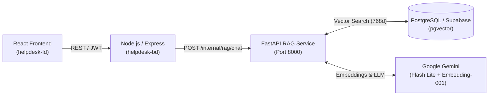

# HelpDesk RAG Service

> AI-powered Retrieval-Augmented Generation (RAG) microservice for the [HelpDesk FullStack](https://github.com/Akshithreddy89/Help-Desk) project.

---

## 📌 Overview

This service provides an intelligent, grounded knowledge assistant for the **HelpDesk** customer support platform. It answers customer troubleshooting and policy questions using verified knowledge base documents—preventing hallucinations and attaching verifiable source citations.

It runs as a standalone **FastAPI** service and is consumed internally by the [HelpDesk Node.js Backend](https://github.com/Akshithreddy89/Help-Desk).

---

## 🏗️ Architecture



### Key Capabilities:
- **Grounded Q&A:** Answers questions strictly using indexed documentation.
- **Source Citations:** Returns document names, sections, and page numbers.
- **Fast-Path Filter:** Instantly responds to basic greetings with zero token usage.
- **Document Ingestion:** Automated CLI pipeline to extract, chunk, and embed `.pdf`, `.md`, and `.txt` files.

---

## 🛠️ Tech Stack

| Component | Technology |
|---|---|
| **Framework** | FastAPI (Python 3.11+) |
| **LLM & Embeddings** | Google Gemini (`gemini-3.5-flash-lite`, `gemini-embedding-001`) |
| **Vector Database** | PostgreSQL / Supabase with `pgvector` |
| **Database Client** | `psycopg3` + `psycopg-pool` |
| **Validation** | Pydantic v2 |
| **Document Parsing** | PyMuPDF (`pymupdf4llm`) |

---

## 🚀 Quick Start

### 1. Clone & Setup Environment
```bash
git clone https://github.com/Akshithreddy89/Help-Desk-RAG.git
cd Help-Desk-RAG

# Create virtual environment
python -m venv .venv
# Activate: Windows (PowerShell) -> .\.venv\Scripts\Activate.ps1 | Linux/Mac -> source .venv/bin/activate

# Install dependencies
pip install -r requirements.txt
```

### 2. Environment Variables
Copy `.env.example` to `.env` and fill in your keys:
```bash
cp .env.example .env
```
Key variables:
- `DATABASE_URL`: PostgreSQL connection string with `pgvector` enabled.
- `GEMINI_API_KEY`: Your Google Gemini API key.

### 3. Initialize Database & Ingest Knowledge Base
```bash
# Set up vector extension and SQL tables
python scripts/init_db.py

# Place your docs in knowledge_base/documents/ and ingest
python scripts/ingest_documents.py
```

### 4. Run the Service
```bash
uvicorn app.main:app --reload --port 8000
```
- API Docs: `http://127.0.0.1:8000/docs`
- Health check: `http://127.0.0.1:8000/health`

---

## 📡 API Reference

### `POST /internal/rag/chat`
Processes questions using vector similarity retrieval and Gemini LLM.

**Request:**
```json
{
  "question": "How do I fix my weak Wi-Fi signal?"
}
```

**Response:**
```json
{
  "answer": "Move within 15–20 feet of the router and ensure you are connected to the 5GHz band...",
  "sources": [
    {
      "document": "wifi_troubleshooting.pdf",
      "section": "Weak Signal Troubleshooting",
      "page_number": 2
    }
  ]
}
```

---

## 🔗 HelpDesk Integration

To connect with the main **[Help-Desk Backend](https://github.com/Akshithreddy89/Help-Desk)**, add the following to `helpdesk-bd/.env`:

```ini
PYTHON_RAG_URL=http://127.0.0.1:8000
```
The Node.js backend routes customer chat queries from `/api/chatbot/message` directly to this service.

---

## 👤 Author

- **Akshith Reddy** - [@Akshithreddy89](https://github.com/Akshithreddy89)
- **Main Project:** [Help-Desk FullStack](https://github.com/Akshithreddy89/Help-Desk)
